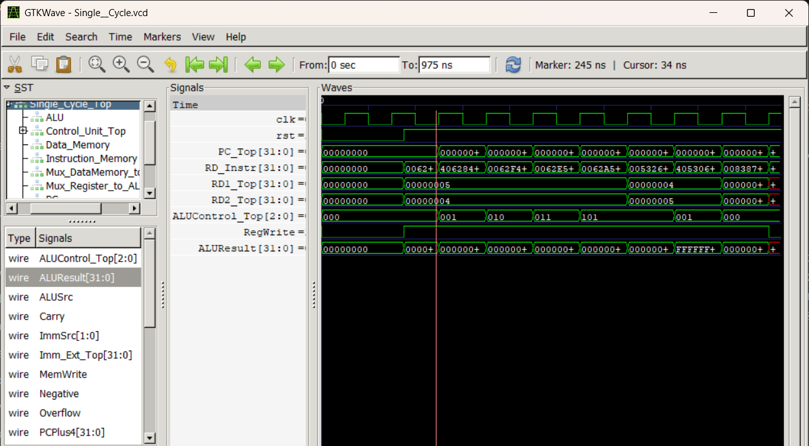
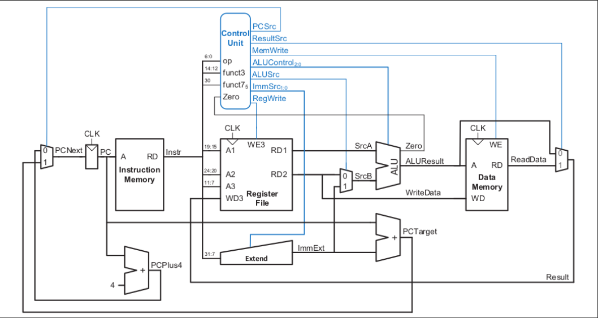

# 32-Bit Single-Cycle RISC-V (RV32I) Processor

A modular implementation of a single-cycle 32-bit RISC-V integer processor in Verilog HDL. Every instruction is fetched, decoded, executed and written back in a single clock cycle.

The design uses separate instruction and data memories (Harvard-style), a 32-entry register file, an ALU with its own decoder, and a main control decoder. Each major block has a unit testbench, and a top-level testbench runs a program loaded from `memfile.hex`. Simulation is done with open-source tools (Icarus Verilog and GTKWave), and the design is intended for FPGA synthesis with Intel Quartus Prime.



---

## Table of Contents

- [Features](#features)
- [Architecture](#architecture)
- [Repository Structure](#repository-structure)
- [Supported Instructions](#supported-instructions)
- [Getting Started](#getting-started)
- [Testing and Verification](#testing-and-verification)
- [Roadmap](#roadmap)
- [License](#license)

---

## Features

- 32-bit RISC-V integer datapath (RV32I subset, see [Supported Instructions](#supported-instructions))
- Single-cycle execution: one instruction per clock, CPI = 1
- Two-level control: main decoder (opcode) feeding an ALU decoder (`funct3` / `funct7`)
- ALU operations: `ADD`, `SUB`, `AND`, `OR`, `SLT`
- Separate instruction and data memories
- Program loaded from a hex file (`memfile.hex`)
- Unit testbenches for the ALU, ALU decoder and main decoder
- Top-level testbench with waveform dump (`Single_Cycle.vcd`) using a `1ns/1ps` timescale
- Open-source simulation flow (Icarus Verilog + GTKWave)

---

## Architecture



*Datapath diagram credit: [MERL-DSU/RISCV_Single_Cycle_Core](https://github.com/merldsu/RISCV_Single_Cycle_Core) (Apache-2.0).*

### Modules

| File | Description |
|---|---|
| `Single_Cycle_Top.v` | Top-level module connecting the full datapath and control |
| `PC.v` | Program counter register with active-low reset |
| `PC_Adder.v` | Computes `PC + 4` for sequential execution |
| `Instruction_Memory.v` | Read-only instruction memory, initialized from `memfile.hex` (unused locations are zero-filled) |
| `Register_File.v` | 32 x 32-bit registers, two asynchronous read ports, one synchronous write port |
| `Sign_Extend.v` | Immediate generator that sign-extends the immediate field |
| `ALU.v` | 32-bit ALU: `ADD`, `SUB` (two's complement), `AND`, `OR`, `SLT`, selected by `ALUControl`, with `Zero`, `Negative`, `Carry` and `Overflow` flags |
| `Data_Memory.v` | Data memory for load and store instructions |
| `Mux.v` | 2-to-1 multiplexer used in the datapath |
| `Control_Unit_Top.v` | Wraps the main decoder and ALU decoder |
| `main_decoder.v` | Decodes the opcode into control signals (`RegWrite`, `MemWrite`, `ALUSrc`, `ResultSrc`, `Branch`, `ImmSrc`, `ALUOp`) |
| `Alu_decoder.v` | Decodes `ALUOp`, `funct3` and `funct7[5]` into the 3-bit `ALUControl` signal |

### ALU control encoding

| `ALUControl` | Operation |
|---|---|
| `000` | `ADD` |
| `001` | `SUB` |
| `010` | `AND` |
| `011` | `OR` |
| `101` | `SLT` |

---

## Repository Structure

```
.
├── .gitignore
├── LICENSE                  # Apache License 2.0
├── README.md
├── docs/
│   ├── datapath.png         # Datapath diagram
│   └── waveform.png         # GTKWave simulation screenshot
├── ALU.v
├── Alu_decoder.v
├── Control_Unit_Top.v
├── Data_Memory.v
├── Instruction_Memory.v
├── Mux.v
├── PC.v
├── PC_Adder.v
├── Register_File.v
├── Sign_Extend.v
├── Single_Cycle_Top.v
├── main_decoder.v
├── memfile.hex              # Test program loaded into instruction memory
├── run_test                 # Helper script to build and run a simulation
├── Single_Cycle_Top_Tb.v    # Top-level testbench
├── tb_ALU.v                 # ALU testbench
├── tb_alu_decoder.v         # ALU decoder testbench
└── tb_main_decoder.v        # Main decoder testbench
```

Generated files such as `*.vcd` waveforms and compiled simulation outputs (`*_sim`) are excluded through `.gitignore`.

---

## Supported Instructions

| Type | Instructions | Status |
|---|---|---|
| R-type | `add`, `sub`, `and`, `or`, `slt` | Implemented and tested |
| R-type | `xor`, `sll`, `srl`, `sra` | Not yet |
| I-type (ALU) | `addi` | Not yet |
| Load | `lw` | Decoded (not yet covered by the test program) |
| Store | `sw` | Decoded (not yet covered by the test program) |
| Branch | `beq` | Not yet |
| Jump | `jal`, `jalr` | Not yet |
| Upper immediate | `lui`, `auipc` | Not yet |

This core implements a subset of RV32I and does not yet cover the complete base ISA.

---

## Getting Started

### Prerequisites

- [Icarus Verilog](https://steveicarus.github.io/iverilog/) (`iverilog`, `vvp`)
- [GTKWave](https://gtkwave.sourceforge.net/) for viewing waveforms
- (Optional) Intel Quartus Prime for FPGA synthesis

On Ubuntu/Debian:

```bash
sudo apt install iverilog gtkwave
```

### Run the full processor simulation

```bash
# 1. Compile the top-level testbench (the design files are pulled in with `include)
iverilog -o Single_Cycle_sim Single_Cycle_Top_Tb.v Single_Cycle_Top.v

# 2. Run the simulation (writes Single_Cycle.vcd)
vvp Single_Cycle_sim

# 3. View the waveforms
gtkwave Single_Cycle.vcd
```

In GTKWave, select `Single_Cycle_Top` in the SST tree and append these signals: `clk`, `PC_Top`, `RD_Instr`, `ALUControl_Top`, `ALUResult` and `RegWrite`. Use *Zoom Fit* to see the whole run.

### Run a unit test (example: ALU)

```bash
iverilog -o alu_sim tb_ALU.v ALU.v
vvp alu_sim
```

The same pattern works for `tb_alu_decoder.v` and `tb_main_decoder.v`.

### Changing the program

`Instruction_Memory.v` loads machine code from `memfile.hex`, one 32-bit instruction per line in hex. Edit this file to run a different program. Make sure the testbench runs long enough to cover every instruction (each instruction takes one 100 ns clock cycle).

---

## Testing and Verification

### Unit testbenches

| Testbench | Verifies |
|---|---|
| `tb_ALU.v` | ALU operations and results |
| `tb_alu_decoder.v` | `ALUControl` output for each `ALUOp` / `funct` combination |
| `tb_main_decoder.v` | Control signals for each supported opcode |

### Top-level test (`Single_Cycle_Top_Tb.v`)

The testbench generates a 100 ns clock (`1ns/1ps` timescale) and holds the active-low reset for 175 ns. Reset is released between clock edges so that the first instruction at address 0 executes. It then runs for 800 ns and dumps the waveform to `Single_Cycle.vcd`.

The registers start with `x5 = 5` and `x6 = 4`. `memfile.hex` runs eight R-type instructions that exercise every ALU operation, including a negative result and a dependent instruction that reads values written by earlier ones:

| PC | Instruction | Machine code | Expected `ALUResult` |
|---|---|---|---|
| `0x00` | `add x7, x5, x6` | `006283B3` | `0x00000009` |
| `0x04` | `sub x8, x5, x6` | `40628433` | `0x00000001` |
| `0x08` | `and x9, x5, x6` | `0062F4B3` | `0x00000004` |
| `0x0C` | `or x10, x5, x6` | `0062E533` | `0x00000005` |
| `0x10` | `slt x11, x5, x6` | `0062A5B3` | `0x00000000` (5 < 4 is false) |
| `0x14` | `slt x12, x6, x5` | `00532633` | `0x00000001` (4 < 5 is true) |
| `0x18` | `sub x13, x6, x5` | `405306B3` | `0xFFFFFFFF` (negative result) |
| `0x1C` | `add x14, x7, x8` | `00838733` | `0x0000000A` (uses x7 and x8 from the first two instructions) |

The waveform at the top of this README shows this run: the PC steps from `0x00` to `0x1C`, `ALUControl` follows each instruction (`000` add, `001` sub, `010` and, `011` or, `101` slt), and `ALUResult` matches the table above.

> After the eighth instruction the PC points at unprogrammed memory, so some signals can briefly show undefined values at the very end of the run.

---

## Roadmap

- [x] ALU with `ADD`, `SUB`, `AND`, `OR`, `SLT`
- [x] Main decoder and ALU decoder
- [x] Register file, memories, PC logic and sign extension
- [x] Top-level single-cycle integration
- [x] Top-level testbench with an 8-instruction test program and waveform
- [ ] `addi` (I-type ALU) and `beq` (branch) support
- [ ] Hardwire register `x0` to zero
- [ ] Remaining RV32I instructions (`xor`, shifts, `jal`, `jalr`, `lui`, `auipc`, sub-word loads and stores)
- [ ] Self-checking top-level testbench (PASS / FAIL output)
- [ ] FPGA synthesis and on-board demo
- [ ] 5-stage pipelined version with hazard handling

---

License

This project is licensed under the Apache License, Version 2.0, the same license as the reference design it is based on. See the LICENSE file for the full text, or visit http://www.apache.org/licenses/LICENSE-2.0.

Unless required by applicable law or agreed to in writing, software distributed under the License is distributed on an "AS IS" BASIS, WITHOUT WARRANTIES OR CONDITIONS OF ANY KIND, either express or implied.

Acknowledgements

This project was built while following a YouTube tutorial on designing a RISC-V single-cycle core, and it is based on the reference design in MERL-DSU/RISCV_Single_Cycle_Core (Copyright 2023 MERL-DSU, licensed under Apache-2.0). The datapath diagram is from that repository.

Extensions and changes in this repository include the slt instruction, an 8-instruction test program, an updated top-level testbench with a reset-timing fix, and the simulation waveform and documentation.

---

## Author

[Avinash barik](https://github.com/Avibarik)
